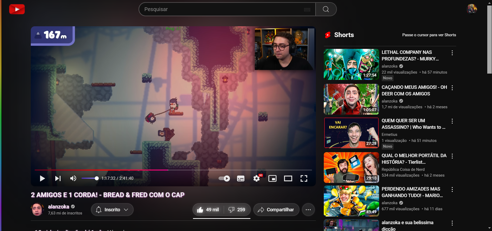
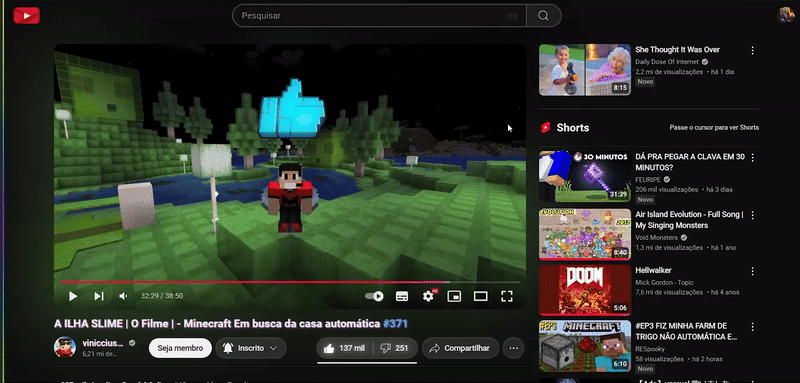
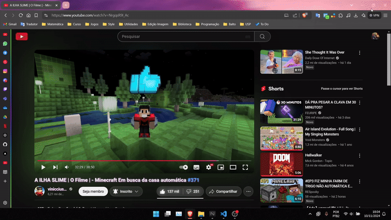

# CSS customizado para o YouTube

Esse é um código CSS que criei para customizar o YouTube e fazer algumas alterações em seu layout para uso pessoal e melhor usabilidade do site.

## Modificações

- **Barra lateral arco-íris animada (RGB)**

     

- **Header**

    

- **Mudanças gerais de cor**

    

- **Ocultamento dos Shorts da tela de vídeo**

Para ver os Shorts passe o cursor por cima.

    

- **Ocultamento da header quando a tela estiver pequena**

Para acessar, na página de vídeo, passe o cursor na parte superior da página.
Em outras páginas como Home e Shorts, passe o cursor por cima do ícone de olho.

    

**Caso não queira ocultar**

Se não quiser que os Shorts ou a header seja ocultada, basta modificar as váriaveis `--neverhideshorts` e `--neverhideheader` para o valor `1` no código CSS em `:root`.

**Outras mudanças mínimas**

- Adição de ícones nos detalhes da playlist na tela de playlist;

- Adição de brilho nos botões like/dislike e título do vídeo;

- Adição de borda enevoada em alguns botões;

- Remoção dos chips/temas da Home (Para acessar minimize a barra lateral);

- Remoção dos chips/temas da página de vídeo (Para acessar abra/expanda a descrição do vídeo)

- Caixa de descrição transparente.

# Como usar

Para utilizar a customização é necessário uma extensão que permita inserir um código CSS no navegador, como por exemplo:

#### [Stylus](https://chromewebstore.google.com/detail/stylus/clngdbkpkpeebahjckkjfobafhncgmne)

Baixe e abra a extensão na página home do YouTube e uma janela flutuante aparecerá, clique no botão de `+` para escrever um novo estilo para o YouTube.

    

Uma aba será aberta, então copie e cole todo o código do arquivo [`youtube.css`](./youtube.css) nessa aba e clique no botão amarelo `Salvar`.

    

Você pode ligar e desligar a customização clicando no botão com a logo da extensão da janela flutuante.

<!-- #### [User JavaScript and CSS](https://chromewebstore.google.com/detail/user-javascript-and-css/nbhcbdghjpllgmfilhnhkllmkecfmpld)

Baixe e abra a extensão na página home do YouTube e uma janela flutuante aparecerá, clique no botão `New rule` para escrever um novo estilo para o YouTube.

    

Uma aba será aberta, então copie e cole todo o código do arquivo [`youtube.css`](./youtube.css) nessa aba, no lado direito, e clique no botão amarelo `Save`.

    

Você pode ligar e desligar a customização clicando no botão alternar na janela flutuante. -->
