# CSS customizado para o YouTube

Esse é um código CSS que criei para customizar o YouTube e fazer algumas alterações em seu layout para uso pessoal e melhor usabilidade do site.

## Modificações

### Barra lateral arco-íris animada (RGB)

    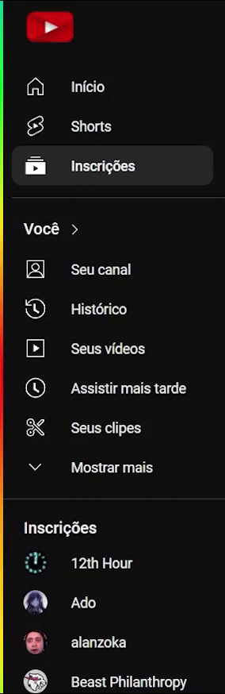 

### Header

    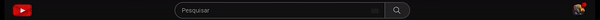

### Ocultamento dos Shorts na página de vídeo

    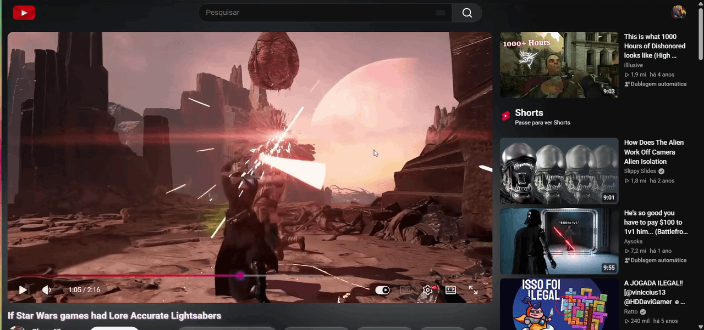

 
Para revelar os Shorts, passe o cursor.

### Ocultamento da header quando a tela estiver pequena

    <strong>Página de vídeo</strong> 
    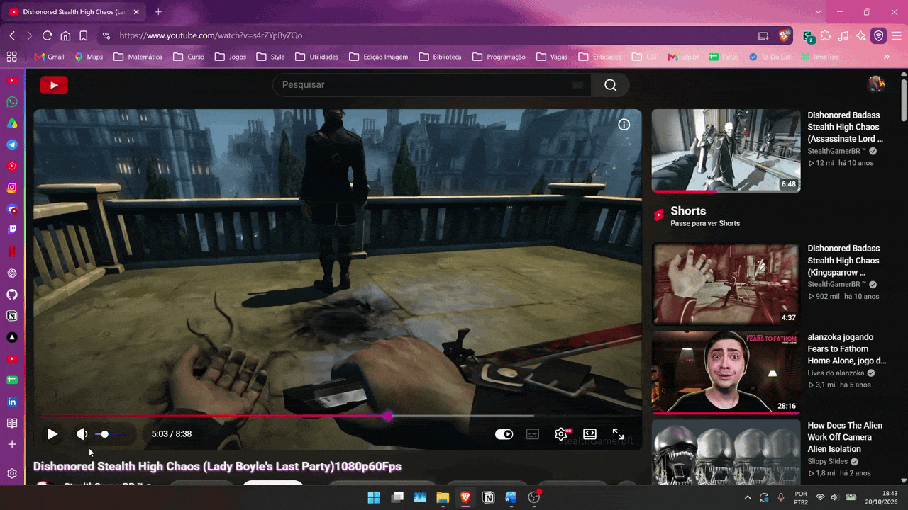

 

    <strong>Home</strong> 
    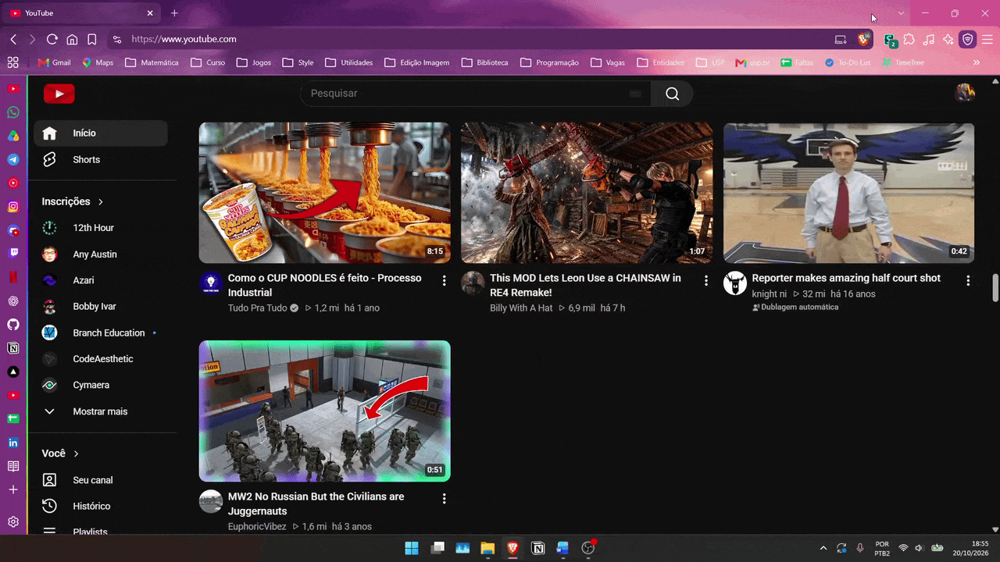

 

  <strong>Melhor aproveitamento da tela em janelas divididas</strong>

<table>
  <tr>
    <td align="center">
      Antes 
      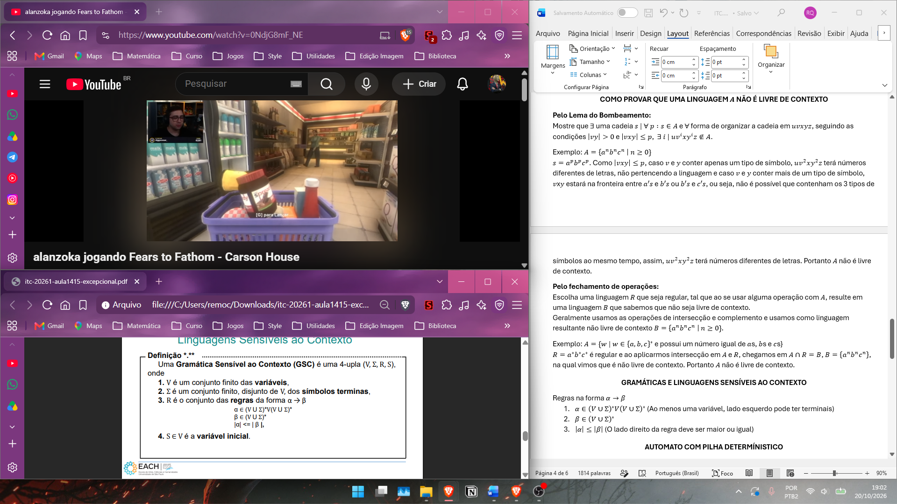
    </td>
    <td align="center">
      Depois 
      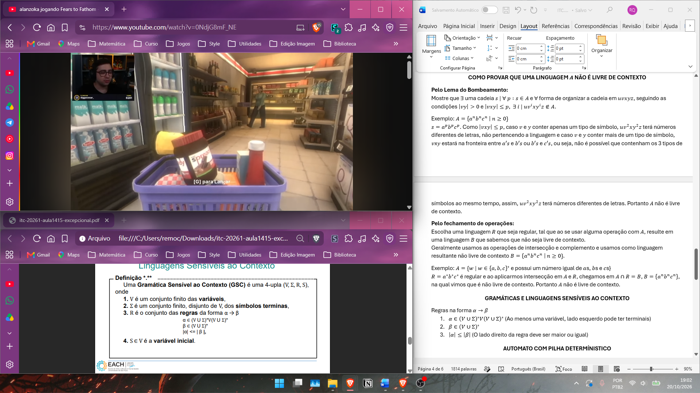
    </td>
  </tr>
</table>

Para revelar a header, na página de vídeo, passe o cursor na parte superior da página. Em outras páginas como Home, Inscrições e Shorts, passe o cursor por cima do ícone de olho.

### Outras mudanças

- Adição de ícones nos detalhes da playlist na tela de playlist;

- Mudança da cor da barra de carregamento da página e da barra de progresso;

- Mudança da cor da barra de volume do vídeo;

- Adição de brilho nos botões like/dislike e título na página de vídeo;

- Adição de borda enevoada em alguns botões;

- Remoção dos chips/temas da Home (Para acessar minimize a barra lateral);

- Remoção dos chips/temas da página de vídeo (Para acessar abra a descrição do vídeo);

- Remoção da cor de fundo da caixa de descrição.

### Caso não queira ocultar

Se não quiser que os Shorts ou a header seja ocultada, ao colar o código CSS, modifique as váriaveis `--keepshorts` ou `--keepheader` para o valor `1` no topo do código.

### Outras configurações

Caso prefira o método de passar o cursor na parte superior da tela para revelar a header, modifique `--hideheadermethod` para `1`.

`--showshadowtitle: 0` para remover brilho dos títulos.

`--shownotificationcircle: 0` para não exibir o círculo de notificação no canto da foto de perfil.

`--rainbowdirection: normal` para inverter a direção da barra RGB.

`--imgyoutubeicon: url('LINKPARAIMAGEM')` para alterar a logo do YouTube.

Também é possível alterar cores ou outras imagens pelas variáveis.

# Como usar

Para utilizar a customização é necessário uma extensão que permita inserir um código CSS no navegador, como por exemplo:

### [Stylus](https://chromewebstore.google.com/detail/stylus/clngdbkpkpeebahjckkjfobafhncgmne)

Baixe e abra a extensão na página home do YouTube e uma janela flutuante aparecerá, clique no botão de `+` para escrever um novo estilo para o YouTube.

    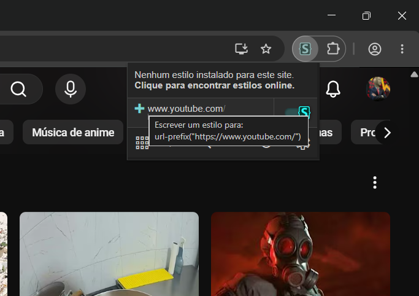

Uma aba será aberta, então copie e cole todo o código do arquivo [`youtube.css`](./youtube.css) nessa aba e clique no botão amarelo `Salvar`.

    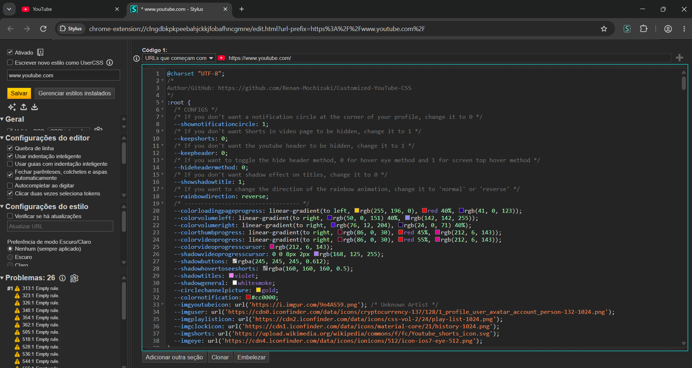

Você pode ligar e desligar a customização clicando no botão com a logo da extensão na janela flutuante.

<!-- #### [User JavaScript and CSS](https://chromewebstore.google.com/detail/user-javascript-and-css/nbhcbdghjpllgmfilhnhkllmkecfmpld)

Baixe e abra a extensão na página home do YouTube e uma janela flutuante aparecerá, clique no botão `New rule` para escrever um novo estilo para o YouTube.

    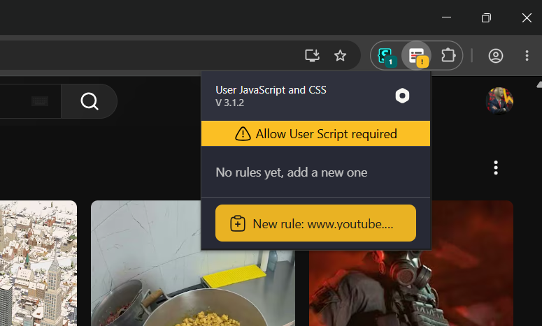

Uma aba será aberta, então copie e cole todo o código do arquivo [`youtube.css`](./youtube.css) nessa aba, no lado direito, e clique no botão amarelo `Save`.

    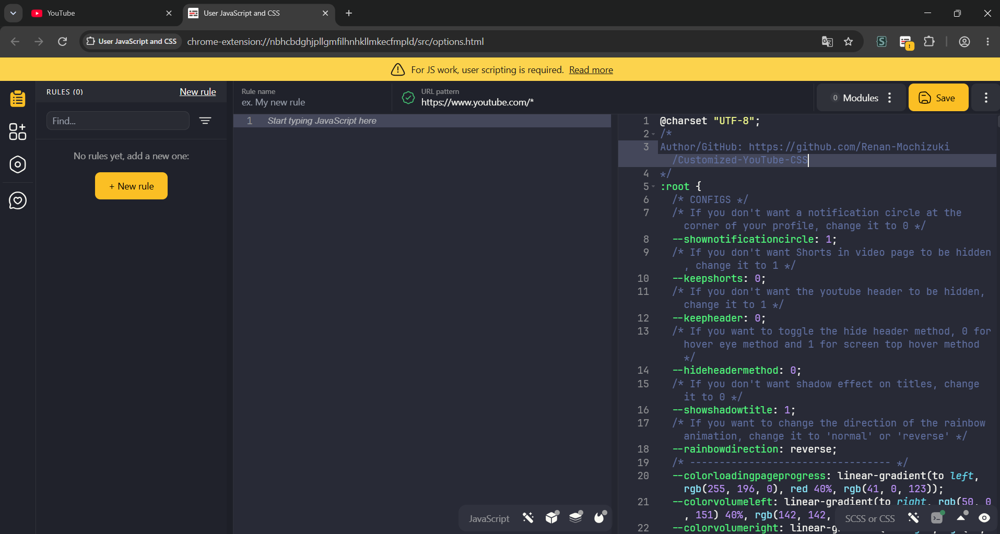

Você pode ligar e desligar a customização clicando no botão alternar na janela flutuante. -->
